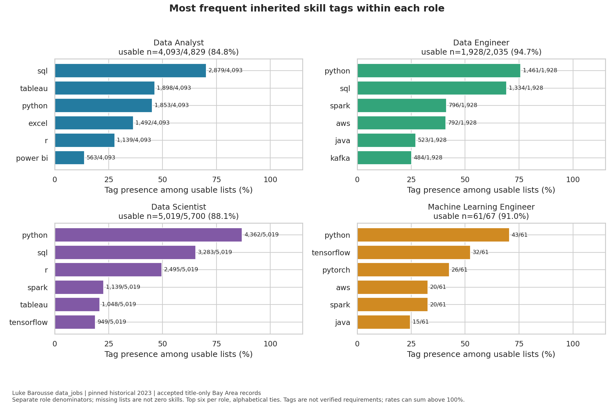

# 2023 Bay Area Data Jobs & Skills Analysis

**Status: Phases 1–4 complete. Phase 5 SQL/CSV preparation and local Tableau XML drafts are ready; native Tableau authoring/acceptance remains pending because Computer Use permissions were not granted. Phase 6 has not started.**

An end-to-end Data Analyst portfolio project examining historical data-career advertisements in the nine-county San Francisco Bay Area. The approved source is Luke Barousse's 2023 dataset. This is a historical observed-record study, not current market intelligence or a count of actual hires.

## Business problem and objectives

A hypothetical workforce intelligence/career-services team wants to understand advertised data-career roles, inherited skill tags and geographic differences to help graduates prioritize learning. Inconsistent titles, missing pay, duplicate candidates and preprocessed fields require transparent definitions.

The project will demonstrate reproducible Python ingestion, relational design, SQL, statistical reasoning and Tableau. Acquisition, quality profiling, commented Python cleaning and a validated local SQLite database are implemented. Reconciled descriptive analysis, charts and executed Jupyter notebooks are complete. Phase 5 exports and local Tableau drafts now exist; native dashboard validation and final portfolio recommendations remain pending. Source limitations are documented instead of filled with invented values.

## Scope and analytical questions

Geography includes Alameda, Contra Costa, Marin, Napa, San Francisco, San Mateo, Santa Clara, Solano and Sonoma counties, including the requested San Francisco, San Jose, Oakland, Palo Alto, Mountain View, Sunnyvale, Santa Clara, Cupertino, Redwood City, Menlo Park, Fremont and Berkeley cities. Phase 2 used a preliminary 101-city diagnostic. Phase 3 retains that reference, adds documented community mappings and a spelling alias, and quarantines unresolved geography. Multi-location and county-only rules are implemented; ambiguous place names are not forced into Bay counties.

Target roles are Data Analyst, Data Scientist, Data Engineer and Machine Learning Engineer across industries and seniorities. Publisher labels are evidence, not our final accepted classifications. Ambiguous original titles remain reviewable; senior labels will not be silently discarded or merged. Remote eligibility and actual work location stay distinct; search_location and employer headquarters do not establish a Bay Area job location.

Phase 4 answers the supported historical questions below; salary comparisons remain disabled:

1. How are historical retained records distributed across the four target roles and explicit title-based seniority?
2. Which publisher-extracted skill tags occur within roles, and what usable-tag coverage supports comparisons?
3. How do role/skill distributions differ across eligible cities, with small samples and multi-location rules visible?
4. What does missingness tell us about the reliability of role, location and pay comparisons?
5. What can comparable publisher-derived annual salary values show, once original units/meaning are established?

Original-text skill requirements, verified advertised salary midpoints, detailed experience requirements, explicit hybrid/on-site shares and population hiring trends are unavailable in this source. No assumption that missing/false flags mean no requirements or on-site work is permitted. The [business requirements](docs/business_requirements.md) and [KPI dictionary](docs/kpi_dictionary.md) contain active dataset amendments and the original stricter conceptual reference.

## Source, license and measured Phase 2 coverage

Source: [Luke Barousse data_jobs](https://huggingface.co/datasets/lukebarousse/data_jobs/blob/ed776e5a0a8c40ea9d5efbd800772ae52e140f3e/README.md), pinned revision `ed776e5a0a8c40ea9d5efbd800772ae52e140f3e`. The publisher declares Apache-2.0. See [data attribution](docs/data_attribution.md) and the [license copy](docs/data_licenses/Apache-2.0.txt). No employer pages were scraped and no credentials were used. Raw redistribution is not enabled; any public outputs require an attribution/embedded-data review.

The verified 231,152,089-byte CSV contains **785,741 raw records and 17 fields**, all with source dates in 2023. Preliminary exact-city matching finds **15,892 records across 87 cities and all nine counties**. These are data-quality diagnostics, not final unique-posting counts or market findings. The [Phase 2 report](reports/phase2_status.md) records role coverage, missingness, duplicate candidates and limitations.

Publisher-derived annual salary values appear in 1,584 preliminary Bay Area records (9.97%); populated inherited skill lists appear in 13,737 (86.44%). All matched work-from-home flags are False, which cannot distinguish hybrid from on-site. Original descriptions, native posting IDs, salary bounds/currency/provenance are absent. No salary median, skill ranking or hiring trend has been calculated.

Greenhouse/Adzuna research and the USAJOBS proposal remain historical alternatives; the active source is Luke's dataset. The blocked Greenhouse configuration is retained separately, never silently cleared.

## Technology and planned architecture

Python 3.11+, pandas, numpy, SQLite via built-in sqlite3, SQL, matplotlib, seaborn, Jupyter Notebook, Tableau on macOS, pytest, Git and GitHub.

```text
Pinned CSV -> Immutable raw data + manifest -> Python cleaning/validation
  -> SQLite -> SQL analytics -> Approved CSV exports -> Tableau -> Business insights
```

The [implemented Phase 3 model](docs/phase3_cleaning_rules.md) contains company/location/skill dimensions, a retained-record fact, skill/location bridges, snapshot metadata and source-row lineage. File-row keys identify lineage, not certified unique vacancies. Named read-only SQL analysis queries are implemented. Phase 5 SQL-to-CSV exports and local Tableau drafts exist; native Tableau acceptance remains pending. Tableau Desktop Public Edition or an appropriate Desktop edition on macOS is planned; Tableau Public uploads must contain only permission-cleared fields/extracts.

## Reproduce Phase 2

From this existing project directory, use Python 3.11+ and the [requirements](requirements.txt):

```bash
python3 -m venv .venv
source .venv/bin/activate
python -m pip install -r requirements.txt
python -m src.luke_dataset acquire
python -m src.luke_dataset profile
PYTEST_DISABLE_PLUGIN_AUTOLOAD=1 python -m pytest -q
```

The local `.venv` already exists; do not recreate it just to read the report. Actual execution used a project environment for acquisition/tests and bundled Python/pandas for the full profile; the [environment record](reports/phase2_test_environment.json) records versions and reproducibility limits. The requirements are ranges, not a full lockfile. SQLite requires no separate Python package; Tableau/Git are external software.

Acquisition needs network access only if the verified snapshot is absent. It downloads the immutable revision, checks publisher file size/SHA-256 and records a manifest. Re-running reuses validated bytes. Profiling/tests are offline. Open [the executed profiling notebook](notebooks/01_data_profiling.ipynb) for real coverage/quality tables. It verifies provenance before reading the stored profile; it contains no fabricated example market data.

## Reproduce Phase 3

Phase 3 uses the already verified local CSV; it makes no network requests and needs no new packages:

```bash
python -m src.build_database
python -m src.phase3_report
PYTEST_DISABLE_PLUGIN_AUTOLOAD=1 python -m pytest -q
```

Read the [brief cleaning report](reports/phase3_cleaning_report.md) and [beginner-friendly rules/schema guide](docs/phase3_cleaning_rules.md). The local database is `data/processed/phase3/job_market.sqlite3`; audit files in that directory explain every row outcome. The build verifies raw/config provenance, protects unmanaged outputs, validates a temporary database before publication and compares relational checksums on reruns. A stale classification review blocks report regeneration until reviewed for the changed content/rules.

The complete 785,741-row input produces **16,223 retained Bay records**, including **12,631 accepted title-only target-role records** and a separately retained role audit cohort. These are cleaning counts, not final job-demand estimates. Exact duplicates across the full file: 101; retained-Bay exact duplicates: 0. Five similar-key candidates were preserved. Phase 3 adds community coverage and excludes one training advertisement; Phase 2 results remain unchanged as historical diagnostics.

## Reproduce Phase 4

Use the validated local Phase 3 database and the existing environment:

```bash
python -m src.run_analysis
python -m src.execute_analysis_notebooks
PYTEST_DISABLE_PLUGIN_AUTOLOAD=1 python -m pytest -q
```

Read the [findings report](reports/phase4_findings.md), [methods guide](docs/phase4_analysis_methods.md), [SQL queries](sql/003_phase4_analysis.sql) and [verification record](reports/phase4_verification.json). Open the executed [exploratory notebook](notebooks/02_exploratory_analysis.ipynb) and [descriptive comparisons notebook](notebooks/03_descriptive_comparisons.ipynb). Local kernel startup requires localhost ports; the notebook runner uses temporary kernel/config/cache paths.

Measured within the **12,631 accepted historical records**, Data Scientist represents 45.1%, Data Analyst 38.2%, Data Engineer 16.1%, and Machine Learning Engineer 0.5% (rounded shares). Among **4,093 usable Data Analyst lists / 4,829 accepted DA records**, SQL appears in 70.3%, Tableau 46.4%, and Python 45.3%. These are inherited tag rates, not verified requirements or market-wide demand. Across the cohort, usable tags cover 87.9%; seniority is unknown for 61.1%.

All nine SQL tables reconcile independently with pandas. Seven source-attributed figures include small-group/coverage notes; logical missingness bounds accompany illustrative descriptive contrasts. No inferential p-values or population/causal claims are made. Salary amounts/comparisons, arrangement shares and hiring trends remain disabled. The raw-directory read stalled, so Phase 4 uses recorded Phase 3 acquisition evidence and verifies the actual SQLite content/file checksum instead of reopening raw data.



## Phase 5 Tableau draft and manual completion

Tableau Public for Apple silicon **2026.3.0** is installed; no installation is needed. Desktop automation returned **Computer Use permissions are not granted**, so no native workbook opening, rendering, filter validation or screenshot is claimed.

```bash
python -m src.tableau_exports
python -m src.tableau_workbook
PYTEST_DISABLE_PLUGIN_AUTOLOAD=1 python -m pytest -q
```

Local outputs are in `data/processed/phase5/`: `dashboard_metrics.csv`, `scope_catalog.csv`, `role_catalog.csv`, and the export manifest. The single metric source has explicit keys, numerators/denominators and suppressed/null rates. Single-choice Role/Scope parameters prevent combining overlapping aggregate alternatives. No joins or multi-select aggregate filters are defined. See the [export dictionary](docs/phase5_export_dictionary.md).

Open `dashboard/bay_area_2023_DRAFT.twbx` locally in Tableau and follow the [authoring/acceptance guide](docs/phase5_tableau_authoring.md). The generated XML draft defines two dashboards and ten sheets for role counts/shares, inherited skills, location associations, explicit seniority, coverage and global classification context. It is **not yet validated in Tableau**; the guide includes a complete CSV-based authoring recipe if the draft needs repair. Save your native work separately as `bay_area_2023_LOCAL.twbx` so regeneration preserves it.

The [reconciliation checklist](reports/phase5_reconciliation.csv) contains matched SQL/CSV controls for seven representative selections; Tableau actual fields remain blank. See [Phase 5 status](reports/phase5_status.md), [export manifest](reports/phase5_export_manifest.json), and [local publication inventory](docs/phase5_publication_review.md). Native screenshots remain pending. Salary values/comparisons, hiring trends and arrangement shares stay disabled; annual-field coverage alone is available.

Do not publish/upload to solve a local connection or save problem. Packaged workbooks contain data copies and remain ignored by Git; public release requires separate approval and license/embedded-data review. Phase 6 is not authorized.

## Repository layout and privacy

- `config/`: approved source/release, access decision and versioned city/county reference; blocked Greenhouse configs are retained as history.
- `data/raw/`: ignored original CSV, source evidence and manifest; `data/processed/phase3/` contains the ignored local database and detailed audits.
- `src/cleaning.py`, `src/build_database.py`, `src/phase3_report.py`: versioned cleaning, validated SQLite build and quality reporting. `src/luke_dataset.py`: approved acquisition and raw quality profiler. `src/phase2.py` retains the blocked legacy Greenhouse offline tool.
- `tests/`: synthetic TEST_ONLY structural tests, not research observations.
- `notebooks/01_data_profiling.ipynb`: Phase 2 raw quality review; notebooks `02` and `03`: executed Phase 4 exploration and descriptive comparisons.
- `docs/`: requirements, KPIs, source evidence/attribution, execution plan, observed field dictionary, architecture, roadmap and Git guide.
- `reports/`: actual raw profiling, cleaning/classification reviews, Phase 4 aggregate analysis/findings and test/verification records. Historical reviews are labeled separately.
- `sql/`: commented schema, database validation and read-only Phase 4 queries. `reports/figures/`: seven Phase 4 charts. `dashboard/`: Phase 5 XML/package drafts and screenshot handoff instructions.
- `src/analysis.py`, `src/analysis_charts.py`, `src/run_analysis.py`, `src/execute_analysis_notebooks.py`: reconciliation, charts, findings and notebook execution.

`.env.example` contains empty names only. No API key is required for this source. `.gitignore` excludes raw/processed data, local databases, secrets, environments, caches and OS metadata. Review notebook outputs and Tableau extracts before sharing. Private GitHub visibility does not replace license compliance. No commit or push was performed in this task; the [Git guide](docs/github_workflow.md) explains the workflow.

## Phases and deliverables

| Phase | Scope | Status |
|---|---|---|
| 1 | Setup, Business Understanding, Data Feasibility | Complete; source-specific amendments recorded |
| 2 | Data Acquisition & Data Profiling | Complete for approved historical Luke source |
| 3 | Data Cleaning, Validation & SQL Database | Complete locally; report and validation recorded |
| 4 | Exploratory & Statistical Analysis | Complete locally; descriptive comparisons, validated charts and executed notebooks |
| 5 | Tableau Dashboard | Local exports/XML drafts ready; native authoring/acceptance pending |
| 6 | Business Recommendations, GitHub Portfolio & Resume | Planned |

The [roadmap](docs/project_roadmap.md) retains the requested five-day accelerated target and its effort/capacity caveats. Native Tableau acceptance and screenshots remain pending in Phase 5. The final business/portfolio brief is Phase 6 and has not started. No public release is authorized.
